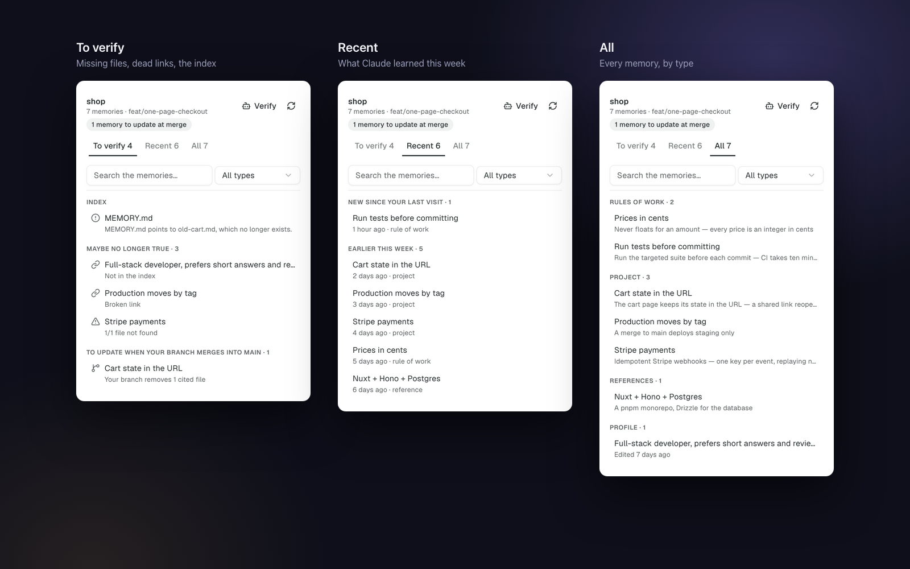

# Claude Memory for Orca

[](https://github.com/PierreB40/claude-memory/actions/workflows/ci.yml) [](LICENSE)

**What Claude Code remembers about the project in front of you, and what no longer holds.**

Claude Code writes memories on its own (`~/.claude/projects/<project>/memory/`) and loads them at
every session. Nobody rereads them. The code moves on, and a memory describing deleted files keeps
steering the agent. This [Orca](https://github.com/stablyai/orca) plugin puts that memory beside
your workspace, checks it against the code, and hands the fixes to a new Claude.



*Captured from the real panel on a demo project and a throwaway git repository (the `showcase`
scenarios of `src/panel.check.ts`). In English or French, as Orca is.
An independent project, not made or endorsed by Anthropic or Stably.*

## Install

Requirements: Orca **1.4.248** or newer, [Claude Code](https://claude.com/claude-code), `git`, and
local workspaces on macOS or Linux.

In Orca, open **Settings → Plugins → Add plugin → From Git URL** and enter:

```text
https://github.com/PierreB40/claude-memory#v0.3.0
```

or from a terminal: `orca plugin install PierreB40/claude-memory@v0.3.0`.

Then open the **Claude Memory** panel in the right sidebar, or click the book in the status bar.

> **Trust matters.** This is a trusted worker: it runs in a Node process with your user account's
> access. It reads memory folders, runs `git` in your workspaces, and never writes a memory itself.
> Review the access Orca lists before approving.

## What it does

**A panel that follows the focused workspace**, like Orca's own tabs: switch workspace and it
switches project. A fixed header (project, branch, *Verify*, tabs, search, type filter) sits
over grouped lists:

- **To verify**: the memories that are maybe no longer true. That covers cited files found neither
  in the workspace nor on the default branch, `[[links]]` that lead to no memory, memories missing
  from `MEMORY.md` (Claude never sees them), and index lines pointing to nothing. A second group, not counted, holds the memories *to update when your
  branch merges*: they cite files your branch removed. The memory is shared by every worktree and
  still true on the default branch, so nothing changes before the merge.
- **Recent**: what Claude wrote this week. New ones since your last visit come first.
- **All**: grouped by type (rules of work, project, references, profile), A to Z.

**A memory opens in place.** You see:
- what is wrong with it;
- its text, with `[[links]]` read as the titles they name;
- what it points to, and what points to it;
- its file, whether it is in the index, and the paths it cites;
- how often Claude read it.

**Verify** starts a *new* Claude in a terminal of the workspace, with the request as its first
message. It fixes what is still useful and *proposes* deletions, never makes them alone. It never
types into an existing terminal.

**When Claude writes a memory**, a notification says so. It warns right away if the memory cites
a file missing from the agent's workspace or links to nothing.

**The status bar** shows the health of the focused project's memory:
- orange with the count to verify;
- green when sound;
- `+n` for new memories.

Clicking it shows or hides the sidebar.

## How it knows

- **Project.** Claude Code files the memory under the main checkout, so every worktree of a
  repository shares one memory. The panel finds it from the focused workspace: a linked
  worktree's `.git` file leads to its main checkout.
- **Code.** A cited path holds if any of these is true:
  - it is in the focused workspace, working tree included (`git ls-files --cached --others
    --exclude-standard`, minus deleted files);
  - it is on the default branch's tip (`origin/HEAD`, else `main`);
  - it is on disk, though git ignores it (`.env`).

  *Removed by your branch* means deleted or renamed between the branch's fork point
  (`git merge-base`) and now. A path whose first folder is no folder of the repository, such as an
  npm package or a domain, is not judged. A path with a placeholder (`__tests__/[name].test.ts`,
  `<app>/x.ts`, `migrations/NNNN_*.sql`) holds when a file fits it.
- **Links.** `[[x]]` leads to the memory whose `name:` is `x`, or, as older memories link, whose
  file is `x.md`.
- **Reads and writes.** An `agent.tool.after` hook sees the tool calls of the agents running in
  Orca. It keeps only `Write`, `Edit`, `MultiEdit` and `Read` calls on a memory file, and never
  holds Orca up.

## Limits

- **Read counts are a minimum.**
  - Reads of one memory less than ten minutes apart count once, because Claude reads long files in
    parts.
  - Only reads through Claude Code's `Read` tool, by an agent running in Orca, are counted. A memory
    opened by `cat` or `grep`, or read in a session outside Orca, is not.
  - Counting starts when the plugin first sees the project.
  - `MEMORY.md` is loaded at every session without a tool call, so it is never counted.
- **Code checks see the focused workspace and the default branch.** A file that exists only on a
  third branch reads as missing.
- **Two workspaces with the same name on the same branch** cannot be told apart: Orca tells a panel
  only the focused workspace's name and branch. The panel says so instead of guessing.
- **Local workspaces only.** A workspace on an SSH host is read as if its path were local.
- **POSIX shells.** *Verify* types `claude '…'` in a new terminal. That works in sh, bash, zsh and
  fish, but not in PowerShell or cmd.
- **The status bar toggles the sidebar, not this panel.** Orca gives plugins no way to show a given
  panel.
- **English or French.** The panel, notifications and the request given to Claude follow Orca's
  language; the worker learns it from the panel, so until a panel has opened once it speaks the
  system's. Palette commands are in English: Orca does not translate a plugin's manifest.

## Without Orca

The same audit runs in a terminal:

```bash
node src/cli.ts                                  # projects that have memories
node src/cli.ts -Users-me-Dev-app ~/Dev/app      # what to verify; exits 1 when anything is
```

## Develop

```bash
npm run setup      # writes Orca's plugin typings into .orca/types
npm run dev        # loads the folder into Orca and reloads on save (asks approval once)
npm test           # the tests, with Orca's test kit
npm run check      # validates, and renders the panel once per scenario in src/panel.check.ts
npm run typecheck
```

| Path | What it is |
| --- | --- |
| `src/audit.ts` | The pure audit: frontmatter, links, index, cited paths, verdicts |
| `src/detect.ts` | Which project a workspace or a tool call is about |
| `src/store.ts` | Memory folders and `git`, read-only |
| `src/worker.ts` | The worker: requests, the hook, the status bar, notifications |
| `src/panel.tsx` | The panel, in Orca components |
| `src/protocol.ts` | The typed contract between panel and worker |
| `fixtures/projects/` | Demo memories used by the tests, the checks and the screenshots |
| `assets/` | Listing icon, cover and screenshot; `assets/src/` renders them (`npm run assets`) |

CI validates the manifest with Orca's own validator and runs the CLI on the fixtures. The tests
need Orca's test kit, so run `npm test` locally before a pull request.

## Contributing

See [CONTRIBUTING.md](CONTRIBUTING.md). Security issues: [SECURITY.md](SECURITY.md).

## License

[MIT](LICENSE)
